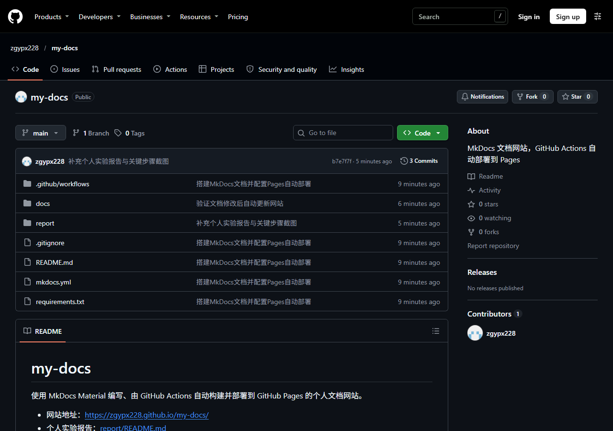
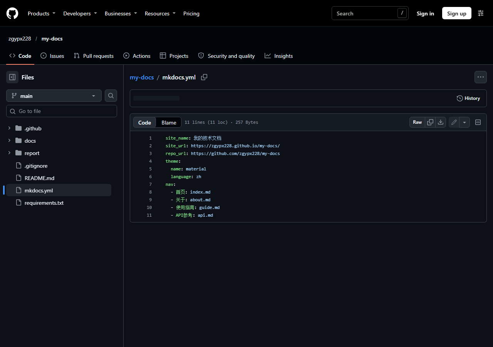
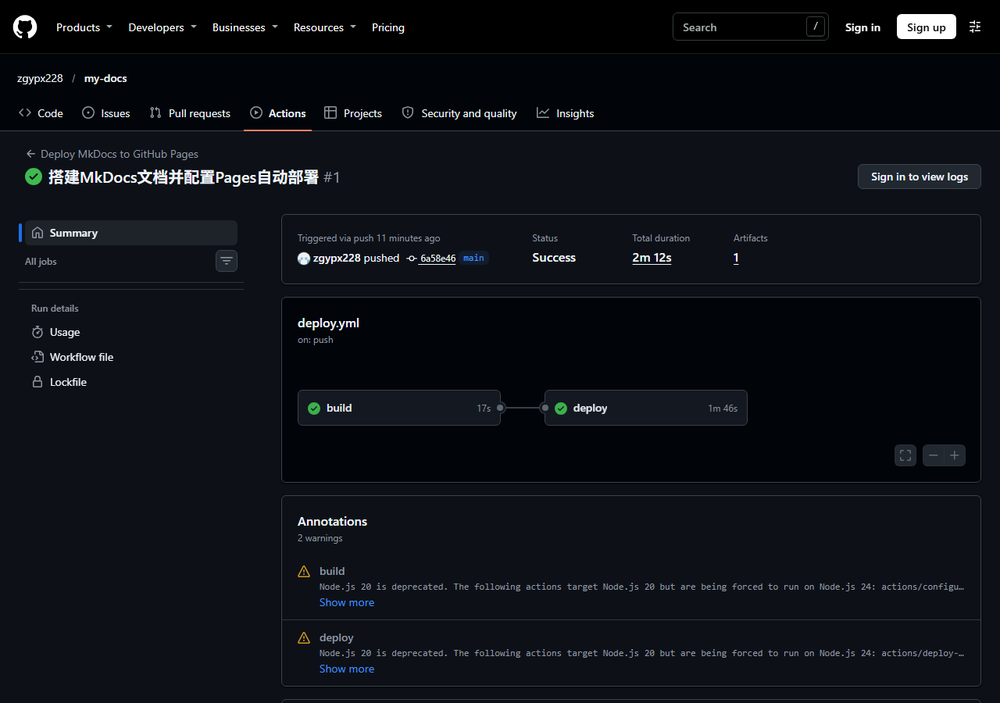
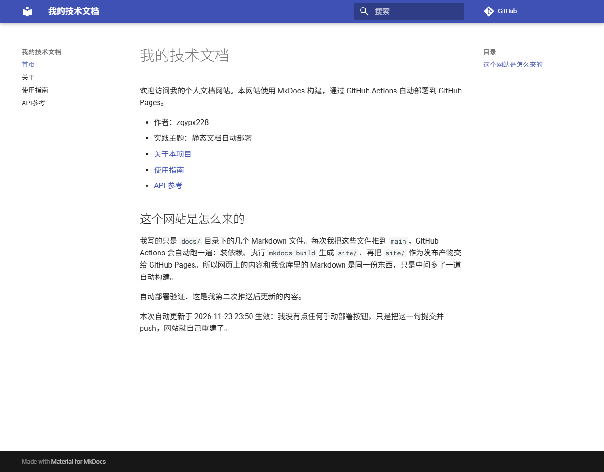
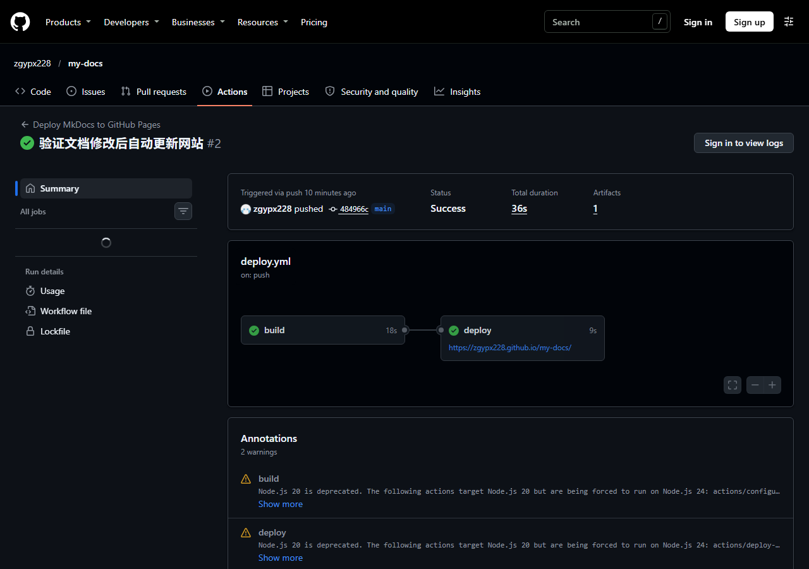

# 实践项目2：个人实验报告

## 1. 基本信息

- GitHub 登录名：zgypx228
- 个人仓库地址：https://github.com/zgypx228/my-docs
- 最终网站地址：https://zgypx228.github.io/my-docs/

## 2. 实践过程与关键截图

### 2.1 仓库创建

在 GitHub 上以本人账号创建公开仓库 `my-docs`，默认分支为 `main`。仓库设为 Public，这样 Pages 站点才能公开访问。

### 2.2 项目结构与 MkDocs 配置

`docs/` 存放网站源码（四页 Markdown），`mkdocs.yml` 的 `nav` 决定生成后的导航顺序，`site/` 是构建产物。

`nav` 里的路径是相对 `docs/` 的，写成 `index.md` 而不是 `docs/index.md`；`site/` 已写入 `.gitignore`，不进入版本库。

### 2.3 本地构建或预览

在虚拟环境中安装依赖后执行 `python -m mkdocs build --strict` 与 `python -m mkdocs serve`，本地检查了四页导航、表格渲染、代码块高亮和页面之间的链接跳转，构建输出为 `Documentation built in 1.44 seconds`，`site/` 目录正常生成。

### 2.4 Pages 设置

Settings → Pages → Build and deployment → Source 选择 **GitHub Actions**，不使用分支发布方式；随后在 Settings → Actions → General 确认仓库允许使用工作流中的 Actions。

### 2.5 Actions 首次构建和部署

推送后工作流自动触发，`build` 与 `deploy` 两个任务均成功。

### 2.6 网站访问与四页导航检查

打开 https://zgypx228.github.io/my-docs/ ，逐一检查首页、关于、使用指南、API 参考四页，导航、表格、代码块与页面内链接均正常。

### 2.7 第二次推送与自动更新验证

在 `docs/index.md` 末尾增加了一句便于辨认的话，再次推送后新的运行自动触发（未点手动部署），刷新网站后新文字出现。

- 对应提交链接：（填写第二次提交的链接）
- 对应 Actions 运行链接：（填写对应运行记录链接）

## 3. 问题与解决

1. **`--strict` 下构建失败**：一开始页面之间的相对链接写成了绝对路径，`mkdocs build --strict` 直接报错退出。改为同级相对链接（如 `about.md`）后通过。收获是本地就用 `--strict`，能提前暴露 Actions 里会失败的问题。
2. **误把 `site/` 提交进去**：第一次 `git add -A` 时把构建产物也加进来了，后来在 `.gitignore` 中忽略 `site/`、`.venv/` 并从暂存区移除。
3. **推送认证**：GitHub 不接受账号密码，改用 Git Credential Manager 的浏览器登录流程完成授权。

## 4. 原理理解

**1. `docs/` 和 `site/` 各保存什么？为什么不用手工修改 `site/`？**
`docs/` 是源码，存 Markdown 和静态资源，是人写的那一份；`site/` 是 `mkdocs build` 生成的 HTML/CSS/JS，是给浏览器看的那一份。`site/` 每次构建都会被重新生成，手工改它的内容会在下一次构建时被覆盖，所以它只作为产物上传，不进版本库。

**2. 本次工作流在什么情况下自动运行？**
推送到 `main` 分支，且改动涉及 `docs/**`、`mkdocs.yml`、`requirements.txt` 或工作流文件本身时触发；另外 `workflow_dispatch` 允许在 Actions 页面手动运行一次。

**3. `build` 与 `deploy` 两个任务有什么区别？**
`build` 负责取源码、装依赖、构建并把 `site/` 上传为产物，它不接触线上环境；`deploy` 通过 `needs: build` 依赖前者，只有在构建成功后，才拿着产物去发布，并写入 `github-pages` 环境。拆成两个任务的好处是：构建失败时不会发生任何线上变更。

**4. 只修改 `report/README.md` 会触发部署吗？为什么？**
不会。`push.paths` 只列了 `docs/**`、`mkdocs.yml`、`requirements.txt` 和工作流文件，报告目录不在其中。报告是给人看的作业材料，改了它网站内容并没有变化，重新构建纯属浪费。

**5. 本次方案为何无需创建 `gh-pages` 分支？**
官方 Pages Actions 走的是"产物（artifact）发布"：`upload-pages-artifact` 把 `site/` 作为工作流产物上传，`deploy-pages` 直接把它发布到 Pages，中间不需要一个长期存在的分支来存构建结果。这样仓库里不会多出一个满是生成文件的分支，也不需要额外配置分支发布权限。
